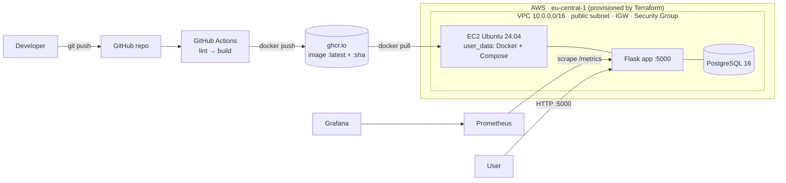
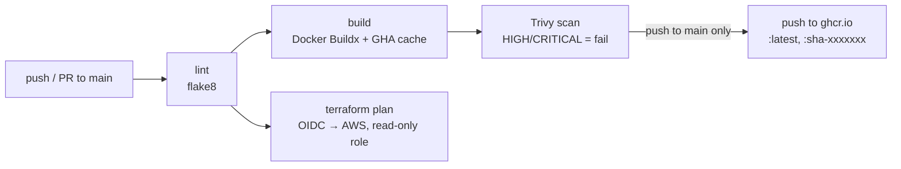

# devops-todo-app

**English** | [Русский](README.ru.md)


An end-to-end DevOps project: taking a simple Flask application from `git push` to a running server on AWS, with containerization, Infrastructure as Code, CI/CD, monitoring and Kubernetes.

The application itself is intentionally simple (a todo list on Flask + PostgreSQL). The focus of the project is not the code but **how the code is built, delivered and observed in production**.

## Architecture



## Tech stack

| Layer | Technology | What was done |
|---|---|---|
| Application | Python, Flask, PostgreSQL | Todo CRUD, configuration via environment variables, DB connection retry |
| Containers | Docker, Docker Compose | Image based on `python:3.12-slim` with a cached dependency layer; DB healthcheck and `depends_on: service_healthy` |
| IaC | Terraform | Remote state in S3 (versioning, encryption, native locking via `use_lockfile`); VPC, subnet, IGW, route table, Security Group, SSH key pair, EC2; Ubuntu AMI resolved via a `data` source instead of a hardcoded ID |
| Deployment | EC2 `user_data` | On first boot the instance installs Docker, pulls the image from ghcr.io and starts the app with PostgreSQL — `terraform apply` gives a working app with no manual steps |
| IaC test environment | LocalStack | Terraform debugged locally at zero AWS cost |
| CI/CD | GitHub Actions | `flake8` → image build → Trivy scan → push to ghcr.io from `main` only; pull requests are built and scanned but not published |
| Security | Trivy, Dependabot | Image scan blocks HIGH/CRITICAL vulnerabilities with an available fix; third-party actions pinned by commit SHA; weekly Dependabot PRs for actions, pip and the base image |
| Cloud access | GitHub OIDC → AWS STS | `terraform plan` runs in CI with short-lived credentials from an IAM role — no AWS access keys stored in GitHub; trust policy pinned to this repo (`main` and pull requests) via the immutable `sub` claim |
| Registry | GitHub Container Registry | `latest` and short commit SHA tags, so any version can be rolled back to |
| Monitoring | Prometheus, Grafana | `/metrics` endpoint via `prometheus-flask-exporter`, Prometheus + Grafana in Docker Compose, dashboard for requests and errors |
| Orchestration | Kubernetes (minikube), NGINX Ingress | Namespace, Secret, PostgreSQL with a PVC, app Deployment with 2 replicas and readiness/liveness probes on `/health`, Ingress |

## CI/CD pipeline



- `lint` and `build` run sequentially (`needs: lint`), so broken code never becomes an image.
- The image is scanned by Trivy **before** it is pushed: a vulnerable image never reaches the registry.
- For pull requests the image is built but not published: the Dockerfile is validated without cluttering the registry.
- Authentication to ghcr.io uses the built-in `GITHUB_TOKEN` with least-privilege permissions (`packages: write`).
- Docker layer cache is stored in the GitHub Actions cache to speed up rebuilds.

### Keyless AWS access via OIDC

The `terraform-plan` job gets AWS credentials without any stored secrets: GitHub issues a short-lived OIDC token (`id-token: write`), AWS STS exchanges it for temporary credentials of the `github-actions-devops-todo-plan` role.

```
"Arn": "arn:aws:sts::965317436147:assumed-role/github-actions-devops-todo-plan/GitHubActions"
```

- The OIDC provider and the role live in a separate Terraform stack, [`terraform/github-oidc/`](terraform/github-oidc/), with its own state key, so `terraform destroy` of the app environment never removes CI access.
- Trust policy checks `aud = sts.amazonaws.com` and `sub` for `main` and pull requests of this repository only.
- The role is read-only (`ReadOnlyAccess`) plus write access to the state lock file only.
- `aws-actions/configure-aws-credentials` and `hashicorp/setup-terraform` are pinned by commit SHA.

## Repository layout

```
.
├── app.py                      # Flask application
├── templates/                  # HTML templates
├── requirements.txt
├── Dockerfile
├── docker-compose.yml          # app + PostgreSQL
├── .github/workflows/ci-cd.yml # CI/CD pipeline
├── terraform/                  # AWS infrastructure (+ LocalStack guide)
│   └── github-oidc/            # OIDC provider + IAM role for GitHub Actions (separate state)
├── docker-compose.ghcr-test.yml # run the published image from ghcr.io locally
├── monitoring/prometheus.yml   # Prometheus scrape config
└── k8s/                        # Kubernetes manifests (namespace → secret → postgres → app → ingress)
```

## Quick start

### Locally with Docker Compose

```bash
git clone https://github.com/madimuk/devops-todo-app.git
cd devops-todo-app
docker compose up -d
# app:        http://localhost:5000
# metrics:    http://localhost:5000/metrics
# Prometheus: http://localhost:9090
# Grafana:    http://localhost:3000 (admin / admin)
```

### Prebuilt image from the registry

```bash
docker pull ghcr.io/madimuk/devops-todo-app:latest
```

### AWS infrastructure

```bash
cd terraform
terraform init
terraform plan
terraform apply
# outputs: instance_public_ip and ssh_command
# the app is available at http://<instance_public_ip>:5000 a few minutes after boot
# always clean up after experiments:
terraform destroy
```

### Kubernetes (minikube)

```bash
minikube start
minikube addons enable ingress
kubectl apply -f k8s/
kubectl get pods -n devops-todo-app
echo "$(minikube ip) todo-app.local" | sudo tee -a /etc/hosts
# app: http://todo-app.local
```

A detailed Terraform guide, including running against LocalStack, is in [terraform/README.md](terraform/README.md) (in Russian).

## Environment variables

| Variable | Default | Description |
|---|---|---|
| `DB_HOST` | `localhost` (`db` in Docker) | Database host |
| `DB_PORT` | `5432` | Database port |
| `DB_NAME` | `tododb` | Database name |
| `DB_USER` | `postgres` | Database user |
| `DB_PASSWORD` | `postgres` | Database password (local development only) |

## Problems solved

Real issues hit during the build and how they were fixed.

**Prometheus: targets in DOWN state**
- *Symptom:* Prometheus could not scrape the application metrics.
- *Cause:* the target in `prometheus.yml` pointed to `localhost`. Inside a container, `localhost` is the Prometheus container itself, not the application.
- *Fix:* use the Docker Compose service name (`app:5000`); containers on the same network resolve each other through Docker's built-in DNS.

**prometheus-flask-exporter failing in debug mode**
- *Symptom:* metric registration errors.
- *Cause:* the Flask debug reloader runs two processes (a file watcher and the application itself), so the exporter was initialized twice.
- *Fix:* disable the reloader (debug mode is never used in production anyway).

**Terraform: AMI lookup on LocalStack**
- *Cause:* LocalStack does not emulate all public AMIs, so the image lookup behaved differently than on real AWS.
- *Fix:* use LocalStack for syntax and logic, verify the AMI lookup against real AWS.

**Trivy: 54 vulnerabilities in Go libraries in a Python image**
- *Cause:* `COPY . .` copied the whole build context into the image, including the Terraform AWS provider binary from `terraform/.terraform/`.
- *Fix:* explicit `COPY` of application files only, plus an extended `.dockerignore`.

**Trivy: HIGH CVE in `zlib1g` from the base image**
- *Fix:* `apt-get upgrade` in the Dockerfile, so OS security patches are applied even when the base image lags behind.

**`.terraform/` accidentally committed to git**
- *Fix:* `git rm -r --cached`, plus `.gitignore` rules (`**/.terraform/*`, `*.tfstate`).

**OIDC: `Not authorized to perform sts:AssumeRoleWithWebIdentity`**
- *Cause:* GitHub now issues an immutable `sub` claim with owner and repo IDs (`repo:madimuk@156674890/devops-todo-app@1354639612:...`), while the trust policy expected the name-based `repo:madimuk/devops-todo-app:...`.
- *Fix:* read the real prefix with `gh api repos/<owner>/<repo>/actions/oidc/customization/sub` and use it in the trust policy.

**OIDC bootstrap: `AccessDenied` on `iam:CreateOpenIDConnectProvider`**
- *Cause:* the Terraform IAM user intentionally has no IAM permissions.
- *Fix:* a temporary inline policy scoped to the OIDC provider and `role/github-actions-*`, removed right after `apply` (IAM write access on roles is a privilege escalation path).

## AWS cost control

- `t2.micro` instance, no NAT Gateway or ALB.
- Terraform syntax is debugged on LocalStack, Kubernetes runs on minikube instead of EKS.
- `terraform destroy` after every experiment; AWS Budgets alerts are enabled.

## Roadmap

- [x] Flask + PostgreSQL
- [x] Docker and Docker Compose
- [x] Terraform: LocalStack → AWS EC2 (eu-central-1)
- [x] CI/CD: GitHub Actions → ghcr.io
- [x] Monitoring: Prometheus + Grafana (local)
- [x] Kubernetes on minikube + NGINX Ingress
- [x] Terraform remote state: S3 + native state locking (`use_lockfile`)
- [x] OIDC for GitHub Actions → AWS instead of long-lived keys
- [ ] Ansible: EC2 configuration and app deployment
- [x] Trivy: image scanning in the pipeline
- [x] Dependabot: weekly updates for actions, pip and Docker
- [ ] SSH restricted to my IP, access via SSM Session Manager
- [ ] Helm chart for the application
