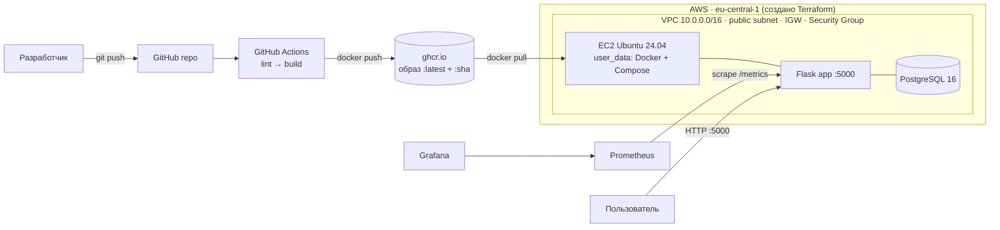
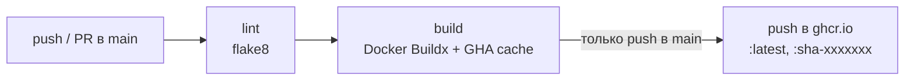

# devops-todo-app

[English](README.md) | **Русский**


End-to-end DevOps-проект: путь простого Flask-приложения от `git push` до работающего сервера в AWS — контейнеризация, Infrastructure as Code, CI/CD, мониторинг и Kubernetes.

Само приложение намеренно простое (todo-список на Flask + PostgreSQL): фокус проекта не на коде, а на том, **как код собирается, доставляется и наблюдается в продакшене**.

## Архитектура



## Стек

| Слой | Технология | Что сделано |
|---|---|---|
| Приложение | Python, Flask, PostgreSQL | CRUD todo-списка, конфиг через переменные окружения, retry подключения к БД |
| Контейнеры | Docker, Docker Compose | Образ на `python:3.12-slim` с кэшированием слоя зависимостей; healthcheck БД и `depends_on: service_healthy` |
| IaC | Terraform | VPC, подсеть, IGW, route table, Security Group, SSH key pair, EC2; AMI Ubuntu ищется через `data` source, без хардкода ID |
| Деплой | EC2 `user_data` | При первом запуске инстанс ставит Docker, скачивает образ из ghcr.io и поднимает приложение с PostgreSQL — после `terraform apply` приложение работает без ручных шагов |
| Тестовая среда IaC | LocalStack | Отладка Terraform локально, без затрат на AWS |
| CI/CD | GitHub Actions | `flake8` → сборка образа → push в ghcr.io только из `main`; для PR — только сборка |
| Registry | GitHub Container Registry | Теги `latest` и короткий SHA коммита — можно откатиться на любую версию |
| Мониторинг | Prometheus, Grafana | Эндпоинт `/metrics` через `prometheus-flask-exporter`, Prometheus + Grafana в Docker Compose, дашборд запросов и ошибок |
| Оркестрация | Kubernetes (minikube), NGINX Ingress | Namespace, Secret, PostgreSQL с PVC, Deployment приложения на 2 реплики с readiness/liveness-пробами на `/health`, Ingress |

## CI/CD pipeline



- `lint` и `build` идут последовательно (`needs: lint`) — сломанный код не превращается в образ.
- Для pull request образ собирается, но не публикуется: проверяем Dockerfile, не засоряя registry.
- Авторизация в ghcr.io через встроенный `GITHUB_TOKEN` с минимальными правами (`packages: write`).
- Кэш слоёв Docker хранится в GitHub Actions cache — повторные сборки быстрее.

## Структура репозитория

```
.
├── app.py                      # Flask-приложение
├── templates/                  # HTML-шаблоны
├── requirements.txt
├── Dockerfile
├── docker-compose.yml          # app + PostgreSQL
├── .github/workflows/ci-cd.yml # CI/CD pipeline
├── terraform/                  # инфраструктура AWS (+ инструкция для LocalStack)
├── docker-compose.ghcr-test.yml # запуск опубликованного образа из ghcr.io локально
├── monitoring/prometheus.yml   # конфиг сбора метрик Prometheus
└── k8s/                        # манифесты Kubernetes (namespace → secret → postgres → app → ingress)
```

## Быстрый старт

### Локально через Docker Compose

```bash
git clone https://github.com/madimuk/devops-todo-app.git
cd devops-todo-app
docker compose up -d
# приложение: http://localhost:5000
# метрики:    http://localhost:5000/metrics
# Prometheus: http://localhost:9090
# Grafana:    http://localhost:3000 (admin / admin)
```

### Готовый образ из registry

```bash
docker pull ghcr.io/madimuk/devops-todo-app:latest
```

### Инфраструктура в AWS

```bash
cd terraform
terraform init
terraform plan
terraform apply
# outputs: instance_public_ip и ssh_command
# приложение откроется на http://<instance_public_ip>:5000 через несколько минут после старта
# после экспериментов — обязательно:
terraform destroy
```

### Kubernetes (minikube)

```bash
minikube start
minikube addons enable ingress
kubectl apply -f k8s/
kubectl get pods -n devops-todo-app
echo "$(minikube ip) todo-app.local" | sudo tee -a /etc/hosts
# приложение: http://todo-app.local
```

Подробная инструкция по Terraform, включая запуск на LocalStack, — в [terraform/README.md](terraform/README.md).

## Переменные окружения

| Переменная | По умолчанию | Описание |
|---|---|---|
| `DB_HOST` | `localhost` (`db` в Docker) | Хост базы данных |
| `DB_PORT` | `5432` | Порт базы данных |
| `DB_NAME` | `tododb` | Имя базы данных |
| `DB_USER` | `postgres` | Пользователь БД |
| `DB_PASSWORD` | `postgres` | Пароль БД (только для локальной разработки) |

## Решённые проблемы

Реальные ошибки, которые возникли в ходе работы, и как они были исправлены.

**Prometheus: targets в статусе DOWN**
- *Симптом:* Prometheus не мог собрать метрики приложения.
- *Причина:* в `prometheus.yml` target был указан как `localhost`. Внутри контейнера `localhost` — это сам контейнер Prometheus, а не приложение.
- *Решение:* указать имя сервиса из Docker Compose (`app:5000`) — контейнеры в одной сети находят друг друга через встроенный DNS Docker.

**prometheus-flask-exporter ломался в debug-режиме**
- *Симптом:* ошибки регистрации метрик.
- *Причина:* debug reloader Flask запускает два процесса — наблюдатель за файлами и само приложение, — и экспортер инициализировался дважды.
- *Решение:* отключить reloader (в продакшене debug-режим не используется).

**Terraform: путь к AMI в LocalStack**
- *Причина:* LocalStack эмулирует не все публичные AMI, поиск образа вёл себя иначе, чем в реальном AWS.
- *Решение:* отлаживать синтаксис на LocalStack, а поиск AMI проверять на реальном AWS.

**Случайный коммит `.terraform/` в git**
- *Решение:* `git rm -r --cached`, добавить правила в `.gitignore` (`**/.terraform/*`, `*.tfstate`).

## Контроль стоимости AWS

- Инстанс `t2.micro`, без NAT Gateway и ALB.
- Синтаксис Terraform отлаживается на LocalStack, Kubernetes — на minikube вместо EKS.
- После экспериментов — `terraform destroy`; настроены алерты AWS Budgets.

## Roadmap

- [x] Flask + PostgreSQL
- [x] Docker и Docker Compose
- [x] Terraform: LocalStack → AWS EC2 (eu-central-1)
- [x] CI/CD: GitHub Actions → ghcr.io
- [x] Мониторинг: Prometheus + Grafana (локально)
- [x] Kubernetes на minikube + NGINX Ingress
- [ ] Terraform remote state: S3 + блокировка
- [ ] OIDC для GitHub Actions → AWS вместо постоянных ключей
- [ ] Ansible: настройка EC2 и деплой приложения
- [ ] Trivy: сканирование образа в pipeline
- [ ] SSH только с моего IP, доступ через SSM Session Manager
- [ ] Helm-чарт для приложения
